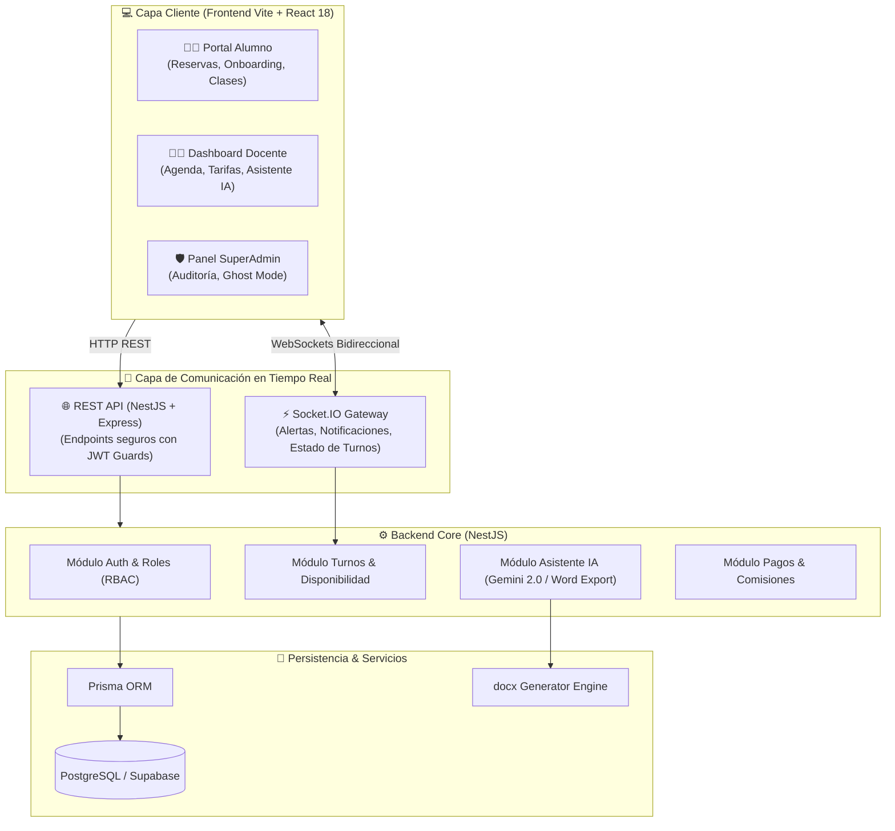

# 🌙 Guardia Nocturna — Plataforma Fullstack de Clases y Guardias Educativas

[](https://www.typescriptlang.org/)
[](https://nestjs.com/)
[](https://react.dev/)
[](https://vitejs.dev/)
[](https://www.prisma.io/)
[](https://www.postgresql.org/)
[](https://socket.io/)
[](https://ai.google.dev/)
[](https://www.docker.com/)

**Guardia Nocturna** es una solución monorepo fullstack empresarial para la gestión, reserva y ejecución de clases particulares y guardias académicas en tiempo real. Integra un asistente pedagógico con Inteligencia Artificial, calendario interactivo sincronizado por WebSockets, gestión multi-rol con **Modo Fantasma (Ghost Mode)** para auditoría administrativa y exportación directa de planificaciones a formato Word (.docx).

---

## 🏛️ Arquitectura del Sistema



---

## 🌟 Características Principales

### 1. 🤖 Asistente Docente con Inteligencia Artificial & Exportación DOCX
- Motor de generación de secuencias didácticas y evaluaciones impulsado por Google Gemini.
- Latencia optimizada (~1.3 segundos por generación).
- Exportación automática con formato universitario estructurado a documentos **Microsoft Word (.docx)** listos para imprimir o compartir.

### 2. 👻 SuperAdmin "Ghost Mode" (Modo Fantasma)
- Permite a los administradores impersonar y navegar la plataforma desde la perspectiva exacta de cualquier docente o alumno.
- Auditoría instantánea sin alterar sesiones de producción ni requerir contraseñas de los usuarios.

### 3. ⚡ Reservas & Disponibilidad en Tiempo Real
- Sincronización bidireccional mediante **WebSockets** (Socket.io) para evitar colisiones de turnos.
- Soporte para modalidades presenciales (a domicilio del alumno o en el aula del docente) y virtuales.
- Geocodificación y cálculo de zonas de cobertura para clases a domicilio.
- Configuración flexible de clases individuales o grupales con límites dinámicos de participantes.

### 4. 💬 Integración Directa con WhatsApp & Aula Virtual
- Acceso directo para contacto telefónico/WhatsApp con mensajes precargados para confirmación inmediata de asistencia.
- Lanzador de aulas virtuales embebido para clases online.

---

## 🚀 Estructura del Proyecto

```
guardia-nocturna/
├── backend/                  # API REST & WebSockets (NestJS + TypeScript)
│   ├── src/
│   │   ├── ai/               # Asistente IA & Generador de Documentos DOCX
│   │   ├── appointments/     # Lógica y controlador de reservas
│   │   ├── auth/             # Autenticación JWT y estrategias de seguridad
│   │   ├── availability/     # Horarios, días y tarifas por materia
│   │   ├── events/           # Gateway de WebSockets para tiempo real
│   │   ├── payments/         # Integración de pagos y liquidaciones
│   │   └── users/            # Gestión de usuarios, perfiles y seeds demo
│   ├── prisma/               # Esquema de base de datos relacional
│   └── Dockerfile            # Construcción multi-stage de producción
│
├── frontend/                 # Aplicación Web SPA (React 18 + Vite + Tailwind)
│   ├── src/
│   │   ├── components/       # Dashboards (Docente, Admin, Alumno, Modales)
│   │   ├── context/          # Estados globales (Auth, Ghost Mode)
│   │   └── services/         # Clientes Axios y conexión de sockets
│   └── vite.config.ts
│
└── docker-compose.yml        # Orquestación lista para 1-click run
```

---

## 🛠️ Instalación y Puesta en Marcha

### Opción A: Despliegue con Docker Compose (Recomendado)

```bash
# 1. Clonar el repositorio
git clone https://github.com/mauro8778/guardia-nocturna.git
cd guardia-nocturna

# 2. Levantar base de datos y backend
docker compose up --build -d

# 3. Iniciar el frontend
cd frontend
npm install
npm run dev
```

### Opción B: Ejecución en Desarrollo Local

#### Requisitos
- **Node.js:** >= 20.x
- **PostgreSQL:** >= 15.x

#### 1. Configurar Backend
```bash
cd backend
npm install
cp .env.example .env
# Configura tu DATABASE_URL en .env
npx prisma db push
npm run start:dev
```
El servidor backend iniciará en `http://localhost:3050`.

#### 2. Configurar Frontend
```bash
cd ../frontend
npm install
npm run dev
```
La aplicación web estará disponible en `http://localhost:5173`.

---

## 👤 Cuentas Demo Precargadas

El backend inicializa automáticamente semillas para pruebas inmediatas:

| Rol | Correo Electrónico | Contraseña | Capacidades |
| :--- | :--- | :--- | :--- |
| **Docente Demo** | `docente@guardia.local` | `Docente1234` | Agenda activa (8 a 23 hs), tarifas de Matemática y Física, Asistente IA |
| **Alumno Demo** | `alumno@guardia.local` | `Alumno1234` | Reserva de turnos, visualización de historial y aula virtual |

---

## 🔒 Seguridad y Buenas Prácticas

- **Cero Fuga de Datos:** Manejo global de excepciones HTTP para ocultar stack traces en producción.
- **Validación Estricta:** DTOs tipados con `class-validator` y `class-transformer`.
- **RBAC (Role Based Access Control):** Guards nativos de NestJS para proteger rutas por privilegios de usuario.
- **Tipado Estricto:** Código libre de `any` garantizado mediante reglas de ESLint y TypeScript.

---

## 📄 Licencia

Este proyecto está licenciado bajo los términos de la licencia MIT.
